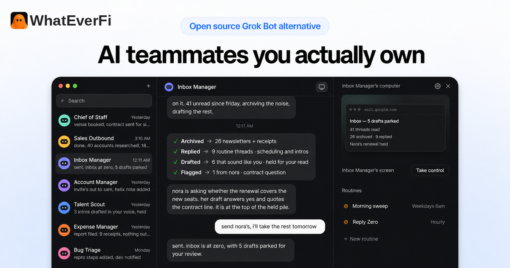
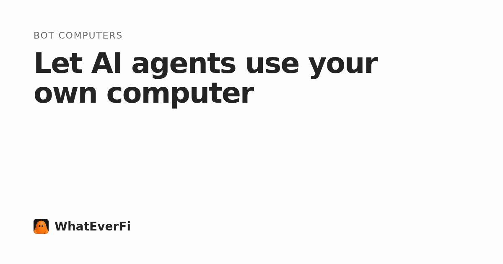

# WhatEverFi

<p align="center">
  
</p>

<p align="center">
  <strong>AI teammates you actually own.</strong><br>
  Operated by <a href="https://regan.studio">Regan.Studio</a>
</p>

<p align="center">
  <a href="https://whateverfi.com"></a>
  <a href="LICENSE"></a>
  <a href="https://github.com/Regan-Studio/whateverfi/stargazers"></a>
</p>

[English](./README.md) · [简体中文](./README.zh-CN.md) · [日本語](./README.ja.md) · [ไทย](./README.th-TH.md)



WhatEverFi is an open source, self-hosted alternative to Grok Bot. It gives you persistent AI teammates with their own memory, routines, apps, and computer. Run it on your machine, with your models and your keys.

Use it on the [web](https://app.whateverfi.com), [desktop](https://whateverfi.com/download/), or from a browser against your own server. Native iPhone and Android apps will ship under the WhatEverFi name; until then, prefer the web app, the desktop app, or self-hosting from this repository.

Learn more at [whateverfi.com](https://whateverfi.com).

**Operated by [Regan.Studio](https://regan.studio). Based on Rakazo (Apache-2.0).**
The Apache-2.0 license and the line `Copyright 2026 Rakazo contributors` are kept in [`LICENSE`](./LICENSE). WhatEverFi and Regan.Studio branding lives in [`overlays/whateverfi/`](./overlays/whateverfi/).

Container images at `ghcr.io/regan-studio/whateverfi` are not published yet and will 404 if pulled. Build and run from this repository until they are. See [`overlays/whateverfi/GHCR-UNPUBLISHED.md`](./overlays/whateverfi/GHCR-UNPUBLISHED.md).

## Features

- Routines that run on a schedule, an email, or a webhook
- Long-term memory
- A computer and a browser for every bot
- Private or shared team computers
- Sandboxes in Docker, the cloud, or on your own machine
- Group chats, delegation, and subagents
- Dashboards and documents you can share by link
- Voice chat and calls
- Any model, with your own keys
- Thousands of app integrations, plus MCP

<table>
<tr>
<td width="50%" valign="top">

### Every bot gets a computer

A browser, terminal, files, and a full desktop. Watch it work, take control to sign in, and hand it back.



</td>
<td width="50%" valign="top">

### Bots that work together

Put bots in a group and @mention them. They split the work, check each other, and report back.


</td>
</tr>
<tr>
<td width="50%" valign="top">

### Routines

Run a bot on a schedule, from an email, or from a webhook, and see every run.


</td>
<td width="50%" valign="top">

### Pages

Bots build live dashboards and documents you can open full screen, share, and ask about.


</td>
</tr>
<tr>
<td width="50%" valign="top">

### Connected apps

Gmail, Slack, GitHub, Notion, Linear and thousands more, plus your own MCP servers and OpenAPI tools.


</td>
<td width="50%" valign="top">

### On every device

Web, desktop, and — soon — iPhone, iPad, and Android, all talking to the same server.


</td>
</tr>
</table>

## Quick start (from source)

You need Node.js 24.15.0 or newer in the 24.x line, or Node.js 26+; pnpm 12; and Docker. Node.js 25.x is not supported. Published container images are not available yet, so start from a checkout of this repository.

```bash
git clone https://github.com/Regan-Studio/whateverfi.git
cd whateverfi
cp .env.example .env
```

Set `POSTGRES_PASSWORD` and `POSTGRES_APP_PASSWORD` to two values from `openssl rand -hex 16`, then put them in `DATABASE_MIGRATION_URL` and `DATABASE_URL`. The app connects as its own `rakazo_app` login, which row-level security applies to; migrations run as the owner ([database roles](docs/self-host-configuration.md#database-roles)). Set `BETTER_AUTH_SECRET`, `ENCRYPTION_KEY`, and `SCREEN_PROXY_SECRET` to independent long random values. Docker sandboxes also need a dedicated `SANDBOX_SUPERVISOR_TOKEN`. You can also set `OPENROUTER_API_KEY`, or connect a supported model provider during onboarding.

Some inherited engine settings still use a `RAKAZO_` prefix (for example `RAKAZO_HOST` or `RAKAZO_DOWNLOAD_BASE`). Those names are part of the runtime and are left as-is so upstream updates keep applying cleanly.

For host-side development with Docker Desktop, set `SANDBOX_CONTROL_VIA_LOOPBACK=true` in `.env`. The supervisor discovers Docker Desktop's user socket automatically; `DOCKER_HOST` or `DOCKER_SOCKET` can override it for another Docker runtime.

Managed app catalogs are optional. Set `COMPOSIO_API_KEY` for Composio, or the `PIPEDREAM_CLIENT_ID`, `PIPEDREAM_CLIENT_SECRET`, and `PIPEDREAM_PROJECT_ID` trio for Pipedream Connect. Users can add an HTTPS MCP server or OpenAPI JSON document from **Integrations** without enabling either managed catalog. Connector credentials are encrypted on the server and are never returned by the API.

Then install and start the stack:

```bash
pnpm install
pnpm dev
```

Open [http://127.0.0.1:5173](http://127.0.0.1:5173), create an account, and connect a model. Local Docker computers are on by default.

For an agent-assisted install, use [SETUP_PROMPT.md](./SETUP_PROMPT.md). Full configuration, secrets, and production hardening are in the [self-hosting guide](./docs/self-host.md).

## Run on a server

Bots stay on when the backend runs on a server. Use the same source checkout on a VPS, then connect from the desktop app or a browser.

Put HTTPS in front of port 5173; [docs/self-host-production.md](./docs/self-host-production.md#public-single-vm-deployment) covers the Caddy setup and host hardening. In the desktop app choose **Existing instance** and enter the `https://` address.

When `ghcr.io/regan-studio/whateverfi` images are published, the Compose installer in `infra/compose/install-images.sh` will be the shorter path. Until then, do not point that installer at a missing registry.

## Architecture

```text
apps/        web, api, worker, desktop, mobile, and public website
packages/    domain, contracts, persistence, adapters, UI, and test tooling
infra/       local services and computer images
docs/        architecture, operations, and release guides
overlays/    WhatEverFi / Regan.Studio branding reapplied on every upstream sync
```

Common checks:

```bash
pnpm lint
pnpm check
pnpm test
pnpm test:integration
pnpm test:e2e
```

See [CONTRIBUTING.md](./CONTRIBUTING.md) for the development workflow and test matrix.

## Staying in sync with upstream

This repository keeps Rakazo's git history, so new upstream work can be merged instead of being copied by hand. The weekly workflow [`.github/workflows/whateverfi-product-sync-upstream.yml`](.github/workflows/whateverfi-product-sync-upstream.yml) fast-forwards the `upstream-mirror` branch, merges, reapplies [`overlays/whateverfi/`](./overlays/whateverfi/), and opens a pull request only after tests, a marketing-site build, and the branding guard pass. It never auto-merges, and it never touches `LICENSE` or the `Copyright 2026 Rakazo contributors` line.

If you change user-visible branding, put the source of truth in `overlays/whateverfi/` (rules in `brand.json`, verbatim files under `files/`) so the next sync does not overwrite it.

## Documentation

- [Self-hosting](./docs/self-host.md)
- [Self-host configuration](./docs/self-host-configuration.md)
- [Self-host secrets](./docs/self-host-secrets.md)
- [Sign-in and accounts](./docs/self-host-accounts.md)
- [Models](./docs/self-host-models.md)
- [Tools and integrations](./docs/self-host-integrations.md)
- [Computer providers](./docs/self-host-sandbox-providers.md)
- [Production deployment](./docs/self-host-production.md)
- [Backup and restore](./docs/self-host-backups.md)
- [Upgrading](./docs/self-host-upgrading.md)
- [Computer runtime and isolation](./docs/computer-runtime.md)
- [Desktop releases](./docs/desktop-release.md)
- [Mobile releases](./docs/mobile-release.md)

Chinese guides cover [self-hosting](./docs/zh-CN/self-host.md), [models](./docs/zh-CN/self-host-models.md), [backups](./docs/zh-CN/self-host-backups.md), [upgrading](./docs/zh-CN/self-host-upgrading.md), and [restricted networks](./docs/zh-CN/self-host-restricted-network.md).

## How WhatEverFi compares

- [Grok Bot](https://whateverfi.com/grok-bot-alternative/)
- [Muse](https://whateverfi.com/muse-alternative/)
- [Dots](https://whateverfi.com/dots-alternative/)
- [Instinct](https://whateverfi.com/instinct-alternative/)
- [OpenClaw](https://whateverfi.com/openclaw-alternative/)
- [Hermes Agent](https://whateverfi.com/hermes-alternative/)
- [All comparisons](https://whateverfi.com/alternatives/)

## License

WhatEverFi is licensed under the [Apache License 2.0](./LICENSE).

It is based on Rakazo (Apache-2.0). Recipients get a copy of that license, and copyright, patent, trademark, and attribution notices from the original source are retained. Apache-2.0 does not grant permission to use the upstream project's trade names, trademarks, or logos. WhatEverFi and Regan.Studio branding is independent and remains with [Regan.Studio](https://regan.studio).

## Contributing

Contributions are welcome. Please read [CONTRIBUTING.md](./CONTRIBUTING.md) and the [Code of Conduct](./CODE_OF_CONDUCT.md) before opening a pull request. For security vulnerabilities, follow [SECURITY.md](./SECURITY.md) instead of filing a public issue.
